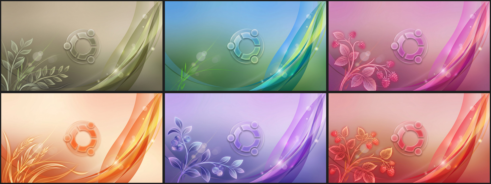
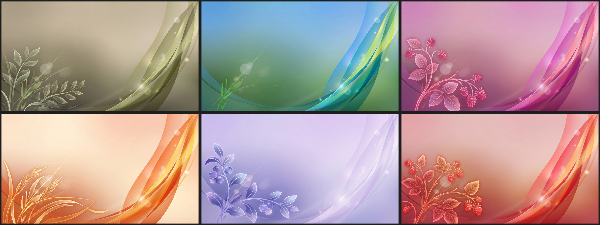

# Yaru Aero Wallpapers

A wallpaper pack that unites the Ubuntu Yaru colors with Windows Aero theming. Glassy, natural flowing waves in six color variants. Frutiger aero with modern look and Yaru colors

> **Note:** The images in this pack are AI-generated with Google Gemini.

### With logo

### No logo

## Contents

Two folders, same six colors in each:

| Folder | Description |
| --- | --- |
| [`with-logo`](with-logo) | With the glass Ubuntu logo in the center |
| [`no-logo`](no-logo) | Clean version, no logo |

Colors: default, bark, magenta, orange, purple, red.

All images are 2752×1536 JPEG.

## Usage

1. Download the images (clone the repo or grab a ZIP via **Code → Download ZIP**).
2. On Ubuntu: right-click the image → **Set as Wallpaper**, or go to **Settings → Appearance → Background**.

## License

This pack is licensed under [CC BY-SA 4.0](https://creativecommons.org/licenses/by-sa/4.0/). You may share and remix it, including commercially, as long as you give credit and release your changes under the same license. See [LICENSE](LICENSE).

## Disclaimer

The Ubuntu logo is a trademark of Canonical Ltd. and is not covered by this license. Canonical is not affiliated with, endorsed by, or in any way connected to this wallpaper pack. This is an unofficial fan project.
